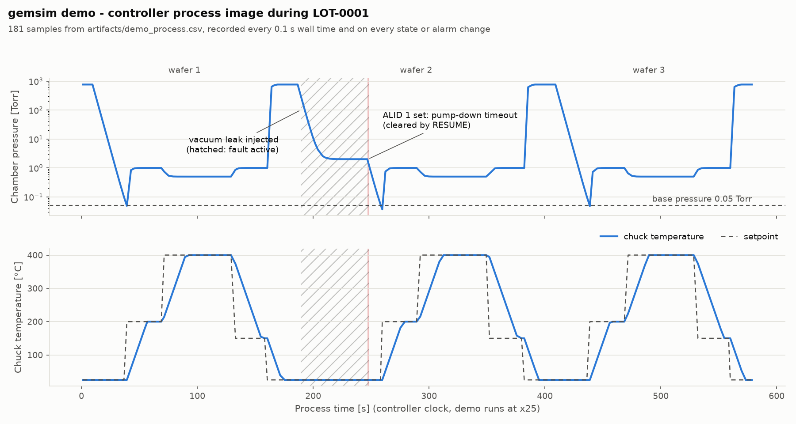
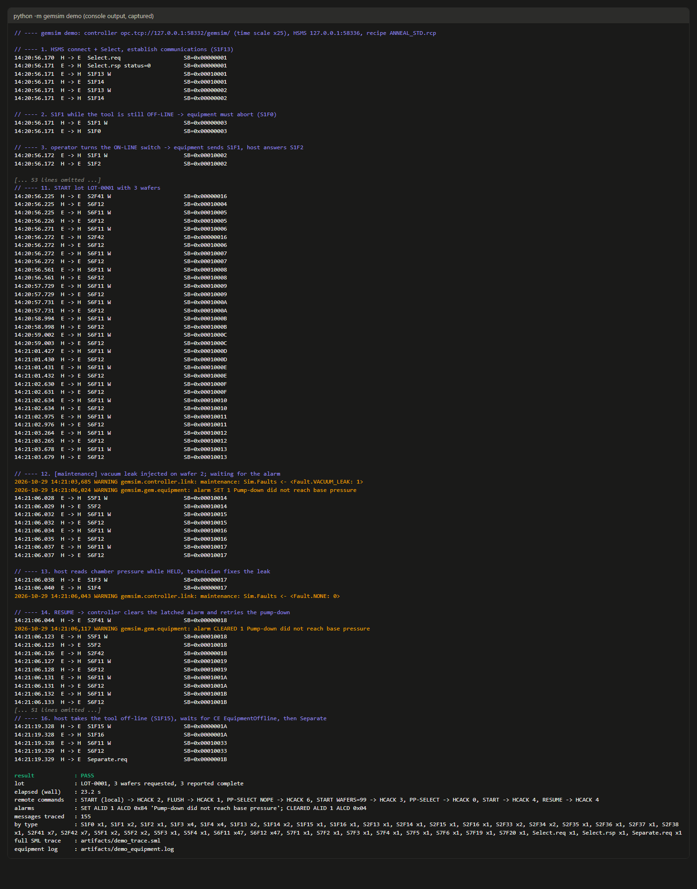
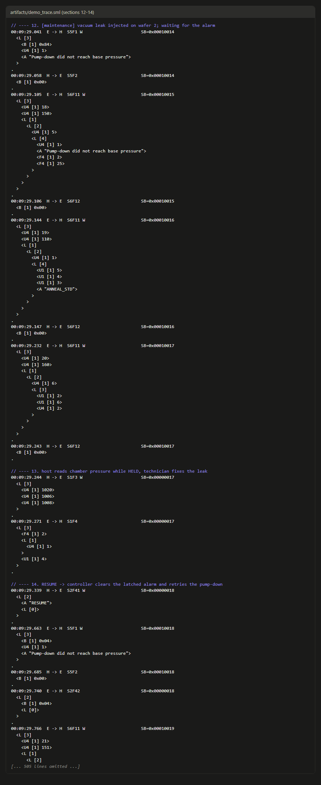

# gemsim: SECS/GEM equipment simulator with an OPC UA PLC bridge

A simulated single-wafer process chamber that talks SECS/GEM (HSMS-SS,
SECS-II, GEM) to a factory host and gets its machine state from a simulated
PLC over OPC UA. I built it to work through the equipment side of fab
automation end to end: transport timers, GEM state models, event reports,
alarms, remote commands, recipes, and what happens when something fails.

The HSMS, SECS-II and GEM layers are written from scratch in typed asyncio
Python. This is a simulator for learning and testing, not a certified GEM
implementation; the tables below list exactly what is implemented.



*Chamber pressure and chuck temperature from the committed demo run. Hatched:
vacuum leak injected on wafer 2. Red line: ALID 1 latched until the host's
RESUME.*

The fault as the host sees it (excerpt from
[`artifacts/demo_trace.sml`](artifacts/demo_trace.sml), other messages omitted):

```text
14:21:06.028  E -> H  S5F1 W                       SB=0x00010014
  <L [3]
    <B [1] 0x84>
    <U4 [1] 1>
    <A "Pump-down did not reach base pressure">
  >
.
14:21:06.044  H -> E  S2F41 W                      SB=0x00000018
  <L [2]
    <A "RESUME">
    <L [0]>
  >
.
14:21:06.123  E -> H  S5F1 W                       SB=0x00010018
  <L [3]
    <B [1] 0x04>
    <U4 [1] 1>
    <A "Pump-down did not reach base pressure">
  >
.
14:21:06.126  E -> H  S2F42                        SB=0x00000018
  <L [2]
    <B [1] 0x04>
    <L [0]>
  >
.
```

ALCD `0x84` is "alarm set, category 4", `0x04` the same alarm cleared. HCACK 4
means "accepted, completion reported by events". Note that the alarm-cleared
S5F1 reaches the host before the S2F42 that answers RESUME.

## Run it

Python 3.12. With GNU make:

```bash
make install   # .venv, pinned dependencies, gemsim in editable mode
make demo      # controller + equipment + host: 3-wafer lot with a fault, ~25 s
make check     # ruff, ruff format --check, mypy --strict, pytest
```

Without make (Windows PowerShell; on Linux/macOS use `.venv/bin/python`):

```powershell
python -m venv .venv
.venv\Scripts\python -m pip install -r requirements-dev.txt
.venv\Scripts\python -m pip install --no-deps -e .
.venv\Scripts\python -m gemsim demo
.venv\Scripts\python -m pytest -q
```

The demo prints one line per message and writes the full SML trace, the
equipment log, a summary and a process CSV to `out/`. The committed copy of one
run is in [`artifacts/`](artifacts/) (`make evidence` refreshes it):
[summary](artifacts/demo_summary.txt), [console](artifacts/demo_console.txt),
[trace](artifacts/demo_trace.sml), [equipment log](artifacts/demo_equipment.log),
[check output](artifacts/check_output.txt).

## What is implemented

| Area | Implemented | Tests |
|---|---|---|
| HSMS-SS (E37, E37.1) | Select, Linktest (on demand and periodic), Separate, Reject.req reasons 1 to 4, Select.rsp 0/1/3; Deselect answered | `test_hsms.py` |
| HSMS timers | T3 reply, T5 connect separation, T6 control transaction, T7 not selected, T8 inter-character (per TCP chunk) | `test_hsms.py` |
| SECS-II items (E5) | L, A, B, BOOLEAN, I1/I2/I4/I8, U1/U2/U4/U8, F4, F8; 1 to 3 length bytes; encodings compared byte for byte with `secsgem` | `test_secs_items.py` |
| Messages | 27 host primaries, 9 equipment primaries (S1F1, S1F13, S5F1, S6F11, S9F1/3/5/7/9), SxF0; full list in [docs/message_coverage.md](docs/message_coverage.md), generated from the dispatch table | `test_coverage.py`, `test_streams.py` |
| Communication state (E30) | WAIT CRA, WAIT DELAY, COMMUNICATING; equipment- and host-initiated S1F13 | `test_control_state.py` |
| Control state (E30) | EQUIPMENT OFF-LINE, ATTEMPT ON-LINE, HOST OFF-LINE, ON-LINE LOCAL/REMOTE; operator switch, S1F15, S1F17 | `test_control_state.py` |
| Processing state | equipment specific: IDLE, READY, EXECUTING, PAUSE, with CE 110 on every change | `test_remote_commands.py`, `test_lot_flow.py` |
| Event reports | S2F33/F35/F37 (DRACK, LRACK, ERACK, all-or-nothing), S6F11 in order, S6F15, S6F19 | `test_reports.py` |
| Alarms | S5F1 with ALCD bit 8 + category, S5F3/F5/F7, CE on every edge | `test_alarms.py` |
| Remote commands | S2F41: PP-SELECT, START, STOP, PAUSE, RESUME, ABORT; HCACK 0 to 6, CPACK 1 to 3 | `test_remote_commands.py` |
| Process programs | S7F1/F3/F5/F17/F19, unformatted, PPBODY as A or B | `test_process_programs.py` |
| Constants, clock, namelists | S2F13/F15/F29 (EAC 0 to 3), S2F17/F31, S1F11/F21/F23 | `test_streams.py` |
| Controller link | OPC UA subscription, event ring, command handshake, heartbeat watchdog, reconnect with backoff | `test_e2e.py`, `test_alarms.py` |

141 tests; last run in [`artifacts/check_output.txt`](artifacts/check_output.txt).

## Architecture

```
 factory host        HSMS-SS / TCP        equipment PC          OPC UA / TCP       machine controller
 (gemsim.host)  <===================>  (gemsim.gem)        <================>  (gemsim.controller)
 scripted lot,       SECS-II messages     comm + control        subscription,      scan cycle: sequencer,
 SML trace                                state, reports,       event ring,        interlocks, physics,
                                          alarms, RCMD, PPs     cmd handshake      latched alarm word
                                                                       ^
                                                     maintenance client (fault injection)
```

The GEM layer never touches the machine model. It reads status tags through an
OPC UA subscription, receives controller events through a 64-entry ring buffer,
and sends commands with a request/acknowledge counter, the usual PLC handshake.
The tag list, command codes and alarm bits live in one interface module,
[`controller/interface.py`](src/gemsim/controller/interface.py), which both
sides import; a test checks that the GEM package does not import the
controller model. [DESIGN.md](DESIGN.md) has the address space, handshake,
state diagrams, ID tables and the reasons behind each choice.

Each process runs one asyncio event loop. Every received HSMS primary is
handled in its own task, so an S2F41 waiting for the PLC acknowledge (up to
3 s) blocks neither the reader nor outgoing events: in the trace, S6F11s
arrive between the START S2F41 and its S2F42. S6F11 and S5F1 go through one
outbound queue and each waits for its reply, so the host sees events in the
order they happened.

The simulated tool runs `LOADING -> PUMPDOWN -> PROCESSING (recipe steps) ->
VENTING -> UNLOADING` per wafer, with a robot timeout, a pump-down timeout and
an over-temperature interlock. A maintenance client can inject `VACUUM_LEAK`,
`ROBOT_STALL` or `HEATER_RUNAWAY`. The bundled recipe
[`recipes/ANNEAL_STD.rcp`](recipes/ANNEAL_STD.rcp) has three steps with
illustrative values. Process time runs at x25 in the demo.

## Fault recovery

| Scenario | What the equipment does | Evidence |
|---|---|---|
| Vacuum leak during pump-down | pump-down timeout latches ALID 1: S5F1 `0x84`, CE 150, CE 110 (to PAUSE), CE 160 with HeldReason 2. RESUME clears the alarm and retries the pump-down: S5F1 `0x04`, CE 151, CE 110, CE 161, lot completes | [trace walkthrough](docs/trace_walkthrough.md), `test_lot_flow.py`, `test_e2e.py::test_demo_lot_with_fault_and_recovery` |
| Robot stall | robot timeout raises ALID 2 (ALCD `0x86`); ABORT clears it and ends the lot with CE 133 | `test_alarms.py::test_robot_stall_alarm_and_abort` |
| Heater runaway | over-temperature interlock trips the heater, ALID 3 (`0x82`); RESUME is refused while the chuck is within 20 °C of the limit | `test_alarms.py::test_over_temperature_interlock`, `test_controller_model.py` |
| Controller (PLC) lost | ALID 10, S2F41 answers HCACK 2, S2F15 answers EAC 2 for machine constants; link reconnects with backoff, ALID 10 clears, PP-SELECT works again | `test_e2e.py::test_controller_loss_and_reconnect_over_opcua`, `test_streams.py` |
| Controller scan stopped (heartbeat frozen) | watchdog raises ALID 10 after 3 s, clears when the heartbeat moves again | `test_alarms.py::test_controller_heartbeat_loss_raises_link_alarm` |
| Host does not acknowledge an S6F11 | T3 expires, equipment sends S9F9 with the header of the unanswered message | `test_streams.py::test_s9f9_when_host_never_acknowledges_an_event` |
| Host does not answer the first S1F13 | WAIT DELAY for EC 3001, back to WAIT CRA, new S1F13 | `test_control_state.py::test_communication_state_retries_after_wait_delay` |
| Link-level failures | T6, T7 and T8 close the connection; a second TCP connection gets Select.rsp 3; a reader failure drops the session | `test_hsms.py` |

## Design decisions

* **Own HSMS/SECS-II/GEM stack, `secsgem` only as a test oracle.** Timer
  behaviour, state models and acknowledge codes are what I wanted to get right,
  so they are implemented directly. The tests compare item and header
  encodings with `secsgem` byte for byte, which catches codec errors that
  round-trip tests cannot.
* **OPC UA between GEM layer and PLC, not Modbus.** Recipe download and the
  event ring need strings and arrays. The GEM layer depends only on an abstract
  `ControllerLink`, so another transport would stay local to one module.
* **Event ring instead of watching state tags.** A subscription delivers the
  latest value per publishing interval, so a state shorter than 50 ms would be
  lost. The controller writes every event into the ring, then bumps an index;
  the GEM side replays the ring in order.
* **Latched alarm word.** A fault shorter than one publishing interval is still
  seen, and the host's RESUME or ABORT is the acknowledge.
* **Tag handshake for commands instead of OPC UA methods.** It works with any
  PLC that exposes plain tags. A missing acknowledge becomes HCACK 2 after 3 s.
* **HCACK 4 for accepted sequencer commands**, because completion is reported
  by collection events (LotCompleted, ProcessHeld, ...).
* **SxF0 while off-line or not communicating** rather than silence, so the host
  does not wait for T3.
* **Recipes validated at PP-SELECT, not at download.** ACKC7 has no code for
  "body invalid"; at PP-SELECT the error can be reported as CPACK 2 on PPID.

## Limitations

* Not a certified GEM implementation and no E30 compliance statement. Written
  from public descriptions of SEMI E5, E30, E37 and E37.1, not from the
  standard documents. Where my reading involves a choice (SxF0 while not
  communicating, CPACK 2 for a missing parameter), DESIGN.md says so.
* Tested against its own host and the `secsgem` encoders only, not against a
  commercial host, a GEM test tool or real equipment.
* Not implemented from E30: spooling (messages are discarded while no host is
  connected), trace data collection (S2F23, S6F1), limits monitoring
  (S2F45 to F48), enhanced remote commands (S2F49), terminal services (S10),
  formatted process programs (S7F23 to F27), S9F11/F13, the DISABLED
  communication state.
* No E87/E90/E40/E94 (carriers, substrates, process and control jobs) and no
  E39/E41 object or exception services. HSMS-SS only, no HSMS-GS, no SECS-I.
* Process programs and report definitions are held in memory only.
* OPC UA runs without security (`NoSecurity`); a real tool would use signed and
  encrypted sessions.
* Chamber physics are first-order toy models; numbers are plausible, not
  representative of any process.
* Developed on Windows 11 with Python 3.12. The CI workflow (Ubuntu and
  Windows) is included but has not run yet. In an earlier round of 19 test
  runs, one stopped at the 120 s pytest timeout; it did not recur and the cause
  was not identified.

## Next steps

* Spooling (S2F43/F44, S6F23/F24), since losing events during a host outage is
  the biggest gap for a production tool.
* E87 carrier management and E40/E94 jobs on top of the existing state models.
* Run the equipment against an independent host (for example the `secsgem`
  host) to test interoperability, not only encodings.
* Persist process programs and report definitions across restarts.

## More detail

* [DESIGN.md](DESIGN.md): address space, handshake timing, state diagrams,
  ID tables (SV, DV, EC, CEID, ALID), error handling, decisions
* [docs/message_coverage.md](docs/message_coverage.md): every implemented
  primary and its direction
* [docs/trace_walkthrough.md](docs/trace_walkthrough.md): start-up, fault and
  shutdown from the committed trace, annotated
* Three separate processes, the way the parts run on a tool:
  `make run-controller`, `make run-equipment`, `make run-host` in three
  terminals; `python -m gemsim host` opens an interactive host shell and
  `python -m gemsim inject VACUUM_LEAK` injects a fault.

| Console output of the demo | SML trace, fault to recovery |
|---|---|
|  |  |

## Repository layout

```
src/gemsim/
  secs/         SECS-II items, messages, SML rendering
  hsms/         framing, connection state machine and timers, endpoints
  gem/          IDs, state models, variables, reports, alarms, RCMD, PP store, equipment
  controller/   PLC interface contract, controller model, scan loop, OPC UA server, links
  host/         scripted GEM host and the lot scenario
  coverage.py   message coverage table from the dispatch table
  demo.py       wiring for the one-command demo
tests/          pytest suite (unit, over real localhost sockets, end to end)
artifacts/      committed output of one demo run and one check run
docs/           coverage table, trace walkthrough, screenshots
scripts/        plot_process.py (matplotlib), render_screenshots.py (Edge, Windows)
```

SEMI, SECS/GEM and the standard numbers are named for identification only. This
project is not affiliated with or endorsed by SEMI. MIT licence.
