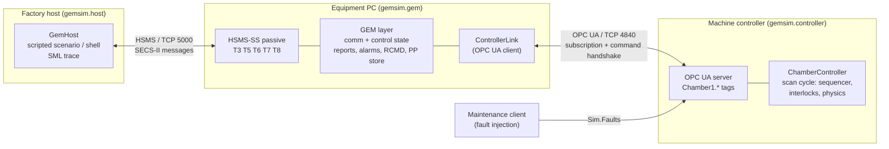

# gemsim – SECS/GEM equipment simulator with a PLC-side bridge

A simulated single-wafer process chamber (load port, wafer-handling robot,
vacuum chamber with heated chuck) that exposes a **SECS/GEM interface over
HSMS** to a factory host. Its machine state comes from a **simulated machine
controller over OPC UA**, the way the PLC of a real tool feeds the GEM layer on
the equipment PC. A scripted host connects, configures reports, downloads and
selects a recipe, runs a lot, handles an injected vacuum fault and logs every
message as SML.

Everything (SECS-II codec, HSMS-SS transport, GEM state models and services)
is written from scratch in typed asyncio Python. It is a learning and
demonstration project: **a simulator, not a certified or compliant GEM
implementation.**

**Result of the last `make demo`** (Windows 11, Python 3.12.10, time scale ×25),
copied from [`artifacts/demo_summary.txt`](artifacts/demo_summary.txt):

```text
result            : PASS
lot               : LOT-0001, 3 wafers requested, 3 reported complete
elapsed (wall)    : 23.4 s
remote commands   : START (local) -> HCACK 2, FLUSH -> HCACK 1, PP-SELECT NOPE -> HCACK 6, START WAFERS=99 -> HCACK 3, PP-SELECT -> HCACK 0, START -> HCACK 4, RESUME -> HCACK 4
alarms            : SET ALID 1 ALCD 0x84 'Pump-down did not reach base pressure'; CLEARED ALID 1 ALCD 0x04
messages traced   : 157
by type           : S1F0 x1, S1F1 x2, S1F2 x1, S1F3 x4, S1F4 x4, S1F13 x2, S1F14 x2, S1F15 x1, S1F16 x1, S2F13 x1, S2F14 x1, S2F15 x1, S2F16 x1, S2F33 x2, S2F34 x2, S2F35 x1, S2F36 x1, S2F37 x1, S2F38 x1, S2F41 x7, S2F42 x7, S5F1 x2, S5F2 x2, S5F3 x1, S5F4 x1, S6F11 x47, S6F12 x47, S7F1 x1, S7F2 x1, S7F3 x1, S7F4 x1, S7F5 x1, S7F6 x1, S7F19 x1, S7F20 x1, Deselect.req x1, Deselect.rsp x1, Select.req x1, Select.rsp x1, Separate.req x1
```

---

## 1. Why GEM matters in a fab

A 300 mm fab runs hundreds of process and metrology tools from many vendors.
The factory host (MES, cell controllers, equipment automation programs) has to
start lots, select recipes, collect process data and react to alarms on all
of them without a custom driver per tool. SEMI's standards make that possible:

* **SEMI E5 (SECS-II)** defines the message structure: streams and functions,
  typed data items, request/reply semantics.
* **SEMI E37 (HSMS)** carries SECS-II messages over TCP/IP, with a small
  session protocol (select, linktest, separate) and timers that define when a
  link is considered dead.
* **SEMI E30 (GEM)** defines the *behaviour* a host can rely on: communication
  and control state models (is the tool talking to me, may I control it?),
  event reports the host defines at run time, alarms, remote commands,
  equipment constants and recipe management.

With GEM a host can bring a new tool into production by configuring reports
and IDs instead of writing new code. Automation and equipment engineers spend
a large part of their time at this interface: tool qualification, integration
with the MES, and finding out why a lot stopped. This project builds that
interface end to end, including the part underneath it that a controls
engineer owns: the PLC that runs the actual sequence.

## 2. Architecture



Plain-text version:

```
 host  <== HSMS (SECS-II) ==>  GEM layer  <== OPC UA ==>  controller (simulated PLC)
 S1F13, S2F33..37, S2F41,      state models,              sequencer, interlocks,
 S5F1, S6F11, S7F3 ...         reports, alarms,           latched alarm word,
                               remote commands            event ring, heartbeat
```

The GEM layer **never touches the machine model directly**. It reads status
tags through an OPC UA subscription, receives controller events through an
event ring buffer, and sends commands with a request/acknowledge counter
handshake. The interface contract (tags, command codes, result codes, event
codes, alarm bits) lives in one module,
[`controller/interface.py`](src/gemsim/controller/interface.py), shared by
both sides. [DESIGN.md](DESIGN.md) has the address space, the handshake
timing, all state diagrams and the reasons behind each choice.

### The simulated tool

Per wafer the controller runs
`LOADING → PUMPDOWN → PROCESSING (recipe steps) → VENTING → UNLOADING`:

* robot transfer: 8 s, with a robot timeout (EC `RobotTimeout`, 20 s)
* pump-down: first-order from 760 Torr to the base pressure (EC `BasePressure`,
  0.05 Torr) with a timeout (EC `PumpDownTimeout`)
* recipe steps: chuck temperature ramps at 10 °C/s to the step setpoint,
  pressure follows the throttle-valve setpoint, step timer
* interlocks: over-temperature trip (EC `TempHighLimit`, 450 °C) turns the
  heater off; START is refused with a wafer in the chamber or an alarm latched
* injectable faults (maintenance client writes `Sim.Faults`): `VACUUM_LEAK`,
  `ROBOT_STALL`, `HEATER_RUNAWAY`

The bundled recipe [`recipes/ANNEAL_STD.rcp`](recipes/ANNEAL_STD.rcp) has three
steps (PREHEAT 200 °C, ANNEAL 400 °C, COOLDOWN 150 °C). Its values are
illustrative and not taken from any real process. Process time is accelerated
(×25 in the demo).

## 3. Supported messages

Direction: **H→E** host sends the primary, **E→H** equipment sends it.
"Yes" means the equipment implements the primary and its reply as described in
[DESIGN.md](DESIGN.md).

### HSMS (E37)

| Message | Status | Notes |
|---|---|---|
| Select.req / .rsp | Yes | status 0 ok, 1 already active, 3 connection exhaust (second TCP connection) |
| Deselect.req / .rsp | Yes | status 0 / 1 |
| Linktest.req / .rsp | Yes | either side; optional periodic linktest |
| Separate.req | Yes | |
| Reject.req | Yes | reasons 1 SType, 2 PType, 3 transaction not open, 4 entity not selected |
| T3 / T5 / T6 / T7 / T8 | Yes | T8 checked per TCP chunk |
| HSMS-GS (multi-session), SECS-I (RS-232) | No | HSMS-SS only |

### SECS-II streams and functions (E5 / E30)

| SxFy | Name | Dir | Status | Notes |
|---|---|---|---|---|
| S1F1/F2 | Are You There | H→E, E→H | Yes | E→H used for ATTEMPT ON-LINE |
| S1F3/F4 | Selected Equipment Status | H→E | Yes | empty list = all SVs; unknown SVID → `<L [0]>` |
| S1F11/F12 | Status Variable Namelist | H→E | Yes | |
| S1F13/F14 | Establish Communications | H→E, E→H | Yes | equipment-initiated on select, with retry delay |
| S1F15/F16 | Request OFF-LINE | H→E | Yes | OFLACK 0 |
| S1F17/F18 | Request ON-LINE | H→E | Yes | ONLACK 0 / 1 / 2 |
| S1F21/F22 | Data Variable Namelist | H→E | Yes | |
| S1F23/F24 | Collection Event Namelist | H→E | Yes | CEID → name + associated DVIDs |
| S2F13/F14 | Equipment Constant Request | H→E | Yes | |
| S2F15/F16 | New Equipment Constant Send | H→E | Yes | EAC 0/1/2/3, all-or-nothing, machine ECs written to the PLC |
| S2F17/F18 | Date and Time Request | H→E | Yes | TimeFormat 0 (12 chars) and 1 (16 chars) |
| S2F29/F30 | Equipment Constant Namelist | H→E | Yes | |
| S2F31/F32 | Date and Time Set | H→E | Yes | kept as an offset; the PC clock is not changed |
| S2F33/F34 | Define Report | H→E | Yes | DRACK 0–4, atomic, delete one / delete all |
| S2F35/F36 | Link Event Report | H→E | Yes | LRACK 0–5, atomic, unlink with empty list |
| S2F37/F38 | Enable/Disable Event Report | H→E | Yes | ERACK 0/1, empty list = all CEIDs |
| S2F41/F42 | Host Command Send | H→E | Yes | START, STOP, PAUSE, RESUME, ABORT, PP-SELECT; HCACK 0–6, CPACK 1–3 |
| S5F1/F2 | Alarm Report Send | E→H | Yes | ALCD bit 8 = set, bits 1–7 = category |
| S5F3/F4 | Enable/Disable Alarm Send | H→E | Yes | empty ALID vector = all |
| S5F5/F6 | List Alarms Request | H→E | Yes | |
| S5F7/F8 | List Enabled Alarms Request | H→E | Yes | |
| S6F11/F12 | Event Report Send | E→H | Yes | sent one at a time in order, each waits for S6F12 |
| S6F15/F16 | Event Report Request | H→E | Yes | |
| S6F19/F20 | Individual Report Request | H→E | Yes | |
| S7F1/F2 | Process Program Load Inquire | H→E | Yes | PPGNT 0/2/3/4 |
| S7F3/F4 | Process Program Send | H→E | Yes | PPBODY as A or B; ACKC7 0/1/2/3/6 |
| S7F5/F6 | Process Program Request | H→E | Yes | unknown PPID → `<L [0]>` |
| S7F17/F18 | Delete Process Program | H→E | Yes | empty list = all; locked while a lot runs |
| S7F19/F20 | Current EPPD Request | H→E | Yes | |
| S9F1/3/5/7 | Unrecognized device ID / stream / function, illegal data | E→H | Yes | MHEAD = received header |
| S9F9 | Transaction Timer Timeout | E→H | Yes | after T3 on an equipment primary |
| S9F11/F13 | Data too long / conversation timeout | E→H | No | |
| S2F23/F24, S6F1 | Trace data collection | – | No | |
| S2F43/F44, S6F23/F24 | Spooling | – | No | messages are discarded while the host is disconnected |
| S2F45–F48 | Limits monitoring | – | No | |
| S2F49/F50 | Enhanced Remote Command | – | No | |
| S3, S16, S14 | Material, process job, object services (E87, E40, E39) | – | No | |
| S5F9–F18 | Exception handling (E41) | – | No | |
| S7F23–F27 | Formatted process programs | – | No | unformatted only |
| S10 | Terminal services | – | No | |
| S12 | Wafer maps | – | No | |

### GEM capabilities (E30)

| Capability | Status |
|---|---|
| State models: communications, control (off-line / local / remote), processing | Yes (processing model is equipment specific, see DESIGN.md §4.4) |
| Establish communications | Yes |
| Event notification and dynamic event report configuration | Yes |
| Variable data collection, status data collection | Yes |
| Alarm management | Yes |
| Remote control | Yes (S2F41) |
| Equipment constants | Yes |
| Process program management | Yes (unformatted) |
| Clock | Yes |
| Error messages (stream 9) | Yes |
| Control: operator- and host-initiated on-line/off-line | Yes |
| Trace data collection, limits monitoring, spooling, terminal services, material movement | No |

## 4. Example trace from a real run

All excerpts below are copied unchanged from
[`artifacts/demo_trace.sml`](artifacts/demo_trace.sml), written by the
`make demo` run summarised at the top (1476 lines, 157 messages, host view).
`H -> E` is host to equipment, `SB` the HSMS system bytes. Lines starting with
`// ----` are annotations written by the scenario script. Values are rendered
by the trace's own SML formatter (`F4` with 6 significant digits).

**Start-up.** The equipment sends S1F13 right after Select.rsp. The host sends
its own S1F13 too. While the tool is still EQUIPMENT OFF-LINE it answers the
host's S1F1 with S1F0. The operator's ON-LINE switch makes the equipment send
S1F1 (ATTEMPT ON-LINE); the host's S1F2 brings it ON-LINE.

```text
// ---- 1. HSMS connect + Select, establish communications (S1F13)
00:03:52.313  H -> E  Select.req                   SB=0x00000001
00:03:52.313  E -> H  Select.rsp status=0          SB=0x00000001
00:03:52.313  E -> H  S1F13 W                      SB=0x00010001
  <L [2]
    <A "GEMSIM-PC1">
    <A "0.1.0">
  >
.
00:03:52.313  H -> E  S1F14                        SB=0x00010001
  <L [2]
    <B [1] 0x00>
    <L [0]>
  >
.
00:03:52.313  H -> E  S1F13 W                      SB=0x00000002
  <L [0]>
.
00:03:52.313  E -> H  S1F14                        SB=0x00000002
  <L [2]
    <B [1] 0x00>
    <L [2]
      <A "GEMSIM-PC1">
      <A "0.1.0">
    >
  >
.

// ---- 2. S1F1 while the tool is still OFF-LINE -> equipment must abort (S1F0)
00:03:52.314  H -> E  S1F1 W                       SB=0x00000003
.
00:03:52.314  E -> H  S1F0                         SB=0x00000003
.

// ---- 3. operator turns the ON-LINE switch -> equipment sends S1F1, host answers S1F2
00:03:52.314  E -> H  S1F1 W                       SB=0x00010002
.
00:03:52.314  H -> E  S1F2                         SB=0x00010002
  <L [0]>
.
```

**Fault and recovery.** The maintenance client sets `Sim.Faults = VACUUM_LEAK`
when wafer 2 is loaded. The pump-down stalls at the 2 Torr leak floor. After
`PumpDownTimeout` (set to 60 s with S2F15 earlier) the controller latches the
alarm bit and holds. The GEM layer sends S5F1 (ALCD `0x84` = set, category 4),
CE 150 AlarmSet, CE 110 ProcessingStateChange (EXECUTING 3 → PAUSE 4) and
CE 160 ProcessHeld (HeldReason 2 = fault). The host reads the pressure (2 Torr),
the leak is fixed and the host sends RESUME. The controller clears the latched
alarm and restarts the pump-down: S5F1 with ALCD `0x04` (cleared), CE 151,
CE 110 back to EXECUTING, CE 161, then PumpDownComplete and the first recipe
step. The alarm-cleared S5F1 arrives *before* the S2F42 that answers RESUME:
the controller acts in its next scan, while the command acknowledgement still
travels back through the OPC UA handshake. A host must not assume that the
reply comes before the events it causes.

```text
// ---- 12. [maintenance] vacuum leak injected on wafer 2; waiting for the alarm
00:04:02.298  E -> H  S5F1 W                       SB=0x00010014
  <L [3]
    <B [1] 0x84>
    <U4 [1] 1>
    <A "Pump-down did not reach base pressure">
  >
.
00:04:02.302  H -> E  S5F2                         SB=0x00010014
  <B [1] 0x00>
.
00:04:02.313  E -> H  S6F11 W                      SB=0x00010015
  <L [3]
    <U4 [1] 18>
    <U4 [1] 150>
    <L [1]
      <L [2]
        <U4 [1] 5>
        <L [4]
          <U4 [1] 1>
          <A "Pump-down did not reach base pressure">
          <F4 [1] 2>
          <F4 [1] 25>
        >
      >
    >
  >
.
00:04:02.314  H -> E  S6F12                        SB=0x00010015
  <B [1] 0x00>
.
00:04:02.315  E -> H  S6F11 W                      SB=0x00010016
  <L [3]
    <U4 [1] 19>
    <U4 [1] 110>
    <L [1]
      <L [2]
        <U4 [1] 1>
        <L [4]
          <U1 [1] 5>
          <U1 [1] 4>
          <U1 [1] 3>
          <A "ANNEAL_STD">
        >
      >
    >
  >
.
00:04:02.326  H -> E  S6F12                        SB=0x00010016
  <B [1] 0x00>
.
00:04:02.327  E -> H  S6F11 W                      SB=0x00010017
  <L [3]
    <U4 [1] 20>
    <U4 [1] 160>
    <L [1]
      <L [2]
        <U4 [1] 6>
        <L [3]
          <U1 [1] 2>
          <U1 [1] 6>
          <U4 [1] 2>
        >
      >
    >
  >
.
00:04:02.335  H -> E  S6F12                        SB=0x00010017
  <B [1] 0x00>
.

// ---- 13. host reads chamber pressure while HELD, technician fixes the leak
00:04:02.336  H -> E  S1F3 W                       SB=0x00000017
  <L [3]
    <U4 [1] 1020>
    <U4 [1] 1006>
    <U4 [1] 1008>
  >
.
00:04:02.361  E -> H  S1F4                         SB=0x00000017
  <L [3]
    <F4 [1] 2>
    <L [1]
      <U4 [1] 1>
    >
    <U1 [1] 4>
  >
.

// ---- 14. RESUME -> controller clears the latched alarm and retries the pump-down
00:04:02.382  H -> E  S2F41 W                      SB=0x00000018
  <L [2]
    <A "RESUME">
    <L [0]>
  >
.
00:04:02.478  E -> H  S5F1 W                       SB=0x00010018
  <L [3]
    <B [1] 0x04>
    <U4 [1] 1>
    <A "Pump-down did not reach base pressure">
  >
.
00:04:02.488  H -> E  S5F2                         SB=0x00010018
  <B [1] 0x00>
.
00:04:02.507  E -> H  S2F42                        SB=0x00000018
  <L [2]
    <B [1] 0x04>
    <L [0]>
  >
.
00:04:02.520  E -> H  S6F11 W                      SB=0x00010019
  <L [3]
    <U4 [1] 21>
    <U4 [1] 151>
    <L [1]
      <L [2]
        <U4 [1] 5>
        <L [4]
          <U4 [1] 1>
          <A "Pump-down did not reach base pressure">
          <F4 [1] 1.14303>
          <F4 [1] 25>
        >
      >
    >
  >
.
00:04:02.528  H -> E  S6F12                        SB=0x00010019
  <B [1] 0x00>
.
00:04:02.535  E -> H  S6F11 W                      SB=0x0001001A
  <L [3]
    <U4 [1] 22>
    <U4 [1] 110>
    <L [1]
      <L [2]
        <U4 [1] 1>
        <L [4]
          <U1 [1] 5>
          <U1 [1] 3>
          <U1 [1] 4>
          <A "ANNEAL_STD">
        >
      >
    >
  >
.
00:04:02.536  H -> E  S6F12                        SB=0x0001001A
  <B [1] 0x00>
.
00:04:02.540  E -> H  S6F11 W                      SB=0x0001001B
  <L [3]
    <U4 [1] 23>
    <U4 [1] 161>
    <L [1]
      <L [2]
        <U4 [1] 6>
        <L [3]
          <U1 [0]>
          <U1 [1] 2>
          <U4 [1] 2>
        >
      >
    >
  >
.
00:04:02.541  H -> E  S6F12                        SB=0x0001001B
  <B [1] 0x00>
.
00:04:02.941  E -> H  S6F11 W                      SB=0x0001001C
  <L [3]
    <U4 [1] 24>
    <U4 [1] 141>
    <L [1]
      <L [2]
        <U4 [1] 3>
        <L [4]
          <U4 [0]>
          <A "">
          <F4 [1] 0.037674>
          <F4 [1] 25>
        >
      >
    >
  >
.
00:04:02.949  H -> E  S6F12                        SB=0x0001001C
  <B [1] 0x00>
```

Report 3 in CE 141 shows a zero-length `<U4 [0]>` and `<A "">`: the step DVs
are not valid for PumpDownComplete, so they are sent empty rather than stale.

**Shutdown.** The host takes the tool off-line and waits for CE 100
EquipmentOffline before Deselect and Separate. An earlier version deselected
straight away; that S6F11 then got Reject.req reason 4 and was lost.

```text
// ---- 16. host takes the tool off-line (S1F15), waits for CE EquipmentOffline, deselect and separate
00:04:15.659  H -> E  S1F15 W                      SB=0x0000001A
.
00:04:15.663  E -> H  S1F16                        SB=0x0000001A
  <B [1] 0x00>
.
00:04:15.663  E -> H  S6F11 W                      SB=0x00010033
  <L [3]
    <U4 [1] 47>
    <U4 [1] 100>
    <L [1]
      <L [2]
        <U4 [1] 1>
        <L [4]
          <U1 [1] 3>
          <U1 [1] 2>
          <U1 [1] 3>
          <A "ANNEAL_STD">
        >
      >
    >
  >
.
00:04:15.663  H -> E  S6F12                        SB=0x00010033
  <B [1] 0x00>
.
00:04:15.665  H -> E  Deselect.req                 SB=0x0000001B
00:04:15.666  E -> H  Deselect.rsp status=0        SB=0x0000001B
00:04:15.666  H -> E  Separate.req                 SB=0x0000001C
```

## 5. Engineering decisions

The full list, with alternatives, is in [DESIGN.md §9](DESIGN.md#9-decisions-and-alternatives).
The ones that shaped the code most:

* **Own HSMS/GEM stack, `secsgem` as a test oracle.** Timer behaviour, state
  models and acknowledge codes are the point of the project, so they are
  implemented directly. The independent `secsgem` library is used in the tests
  to check item and header encodings byte for byte.
* **PLC → GEM split over OPC UA.** The GEM layer depends on an abstract
  `ControllerLink`; the controller is a scan-cycle model with no knowledge of
  SECS. OPC UA was chosen over Modbus TCP because recipe download and the
  event buffer need strings and arrays.
* **Event ring buffer instead of state polling.** A subscription delivers the
  latest value per publishing interval, so short states would be lost. The
  controller writes every event into a 64-entry ring and bumps an index; the
  GEM layer replays the ring in order.
* **Latched alarm word.** A fault shorter than one publishing interval is
  still seen, and the host's RESUME or ABORT is the acknowledge.
* **Command handshake with a sequence counter**, the usual PLC pattern,
  instead of OPC UA methods. A missing acknowledge becomes HCACK 2 after 3 s.
* **HCACK 4 for accepted sequencer commands**, because completion is reported
  by collection events (LotCompleted, ProcessHeld, ...).
* **Serial outbound queue** for S6F11 and S5F1, so the host sees events in the
  order they occurred.

## 6. Limitations

* A simulator, not a certified or production GEM implementation. No compliance
  statement in the E30 sense is made; the tables above are the scope.
* Written from publicly available descriptions of SEMI E5, E30 and E37, not
  from the standard documents themselves. Where the standards leave a choice
  open, or where my reading may differ from them, DESIGN.md says so (for
  example CPACK for a missing parameter, SxF0 while not communicating).
* Tested only against its own host and the `secsgem` encoders, not against a
  commercial host, GEM test tool or real equipment.
* No spooling, trace data collection, limits monitoring, E87/E90/E40/E94
  (carriers, substrates, jobs) or multi-block handling. Process programs are
  held in memory.
* OPC UA without security (`NoSecurity`). A real tool would use signed and
  encrypted sessions and certificates. No reconnect logic: if the controller
  link drops, the equipment raises ALID 10 and refuses remote commands until
  restarted.
* Chamber physics are first-order toy models; numbers are plausible, not
  representative of any process.
* Developed and run on Windows 11 with Python 3.12.10. The GitHub Actions
  workflow (Ubuntu + Windows) is included but has not been run.

## 7. How to run

Requirements: Python 3.12 and GNU make (on Windows, for example
`winget install ezwinports.make`; or call the commands in the Makefile
directly).

```bash
make install     # .venv + pinned dependencies (requirements-dev.txt)
make demo        # full lot with fault and recovery; writes artifacts/
make check       # ruff + mypy --strict + pytest
```

Without make:

```bash
python -m venv .venv
.venv/Scripts/python -m pip install -r requirements-dev.txt    # .venv/bin/python on Linux
PYTHONPATH=src .venv/Scripts/python -m gemsim demo
```

`make demo` prints one line per message and writes:

* `artifacts/demo_trace.sml` – full SML trace (host view)
* `artifacts/demo_equipment.log` – equipment, controller and link log
* `artifacts/demo_summary.txt` – result, HCACKs, alarms, message counts

Options: `python -m gemsim demo --wafers 5 --fault-wafer 3 --time-scale 40 --no-fault --quiet`.

### Three processes, like a real tool

```bash
make run-controller   # terminal 1: OPC UA server on opc.tcp://127.0.0.1:4840/gemsim/
make run-equipment    # terminal 2: GEM equipment, HSMS passive on 127.0.0.1:5000
make run-host         # terminal 3: scripted lot (2 wafers), trace to artifacts/host_trace.sml
```

Interactive host shell (connects to a running equipment; if the tool is off-line, for
example after `make run-host` ended with S1F15, type `online` first):

```bash
PYTHONPATH=src .venv/Scripts/python -m gemsim host
gem> sv 1020 1022
gem> pp-download recipes/ANNEAL_STD.rcp
gem> rcmd PP-SELECT PPID=ANNEAL_STD
gem> rcmd START LOTID=L1 WAFERS=2
gem> events
```

Inject a fault from a fourth terminal:

```bash
PYTHONPATH=src .venv/Scripts/python -m gemsim inject VACUUM_LEAK
PYTHONPATH=src .venv/Scripts/python -m gemsim inject NONE
```

## 8. Tests

Last full run (`make check` on Windows 11, Python 3.12.10): ruff clean, ruff format clean,
`mypy --strict`: no issues in 29 source files, **133 passed in 50.52 s**. Wall time varies
with machine load; 31–62 s were observed across repeated runs. After the timing
fixes described in DESIGN.md §10 the suite ran 17 times: 16 passed, and one
`make check` run stopped at the 120 s pytest timeout (a hang, test not identified).
It did not recur in the 8 runs after it. A plausible cause, the HSMS listener
waiting for unclosed connections at shutdown, was fixed, but the hang was not
reproduced, so that fix is not confirmed as the cause.

| File | Tests | Covers |
|---|---|---|
| `test_secs_items.py` | 29 | codec round trips, length bytes, malformed input, byte equality with `secsgem`, SML |
| `test_hsms.py` | 15 | select/deselect/linktest/separate, T3, T5, T6, T7, T8, all reject reasons, connection exhaust |
| `test_controller_model.py` | 22 | sequence and event order, pump-down time vs. model, command results, interlocks, each fault, pause/stop/abort |
| `test_control_state.py` | 10 | E30 control state transitions, ONLACK codes, off-line SxF0 behaviour, ATTEMPT ON-LINE |
| `test_reports.py` | 11 | DRACK/LRACK/ERACK codes, atomicity, delete/unlink, S6F11 contents, DV validity, S6F15/F19 |
| `test_remote_commands.py` | 16 | every HCACK and CPACK path, LOCAL refusal, PAUSE/RESUME/STOP/ABORT matrix, recipe lock |
| `test_alarms.py` | 6 | fault → S5F1 → CE for each fault, S5F3 disable, S5F5/S5F7, heartbeat watchdog |
| `test_process_programs.py` | 11 | stream 7 codes, binary PPBODY, recipe parser |
| `test_streams.py` | 9 | S9F1/3/5/7/9, namelists, ECs (EAC codes, write-through to the PLC), clock |
| `test_lot_flow.py` | 2 | full lot and vacuum fault recovery over the in-process link |
| `test_e2e.py` | 2 | **controller + OPC UA + GEM + HSMS + host in one process**: the demo scenario, and controller loss → ALID 10 |

## 9. Repository layout

```
src/gemsim/
  secs/         SECS-II items, messages, SML
  hsms/         framing, connection state machine and timers, endpoints
  controller/   interface contract, controller model, scan loop, OPC UA server, links
  gem/          IDs, state models, variables, reports, alarms, remote commands, PP store, equipment
  host/         GemHost and the lot scenario
  trace.py      SML trace hook
  demo.py       wiring for `make demo`
recipes/        ANNEAL_STD.rcp
tests/          pytest suite
artifacts/      output of the last `make demo` (committed as evidence)
DESIGN.md       design notes, state diagrams, ID tables, decisions
```

## 10. Notes

SEMI, SECS/GEM and the standard numbers are referenced for identification only.
This project is not affiliated with or endorsed by SEMI or any equipment or
semiconductor company. MIT licence.
